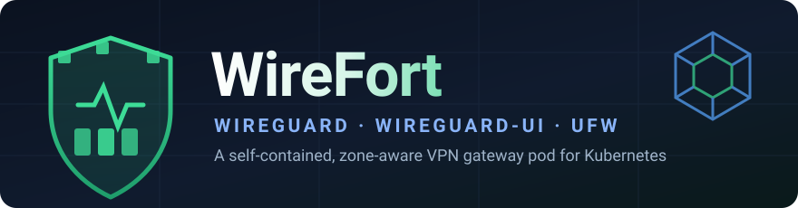
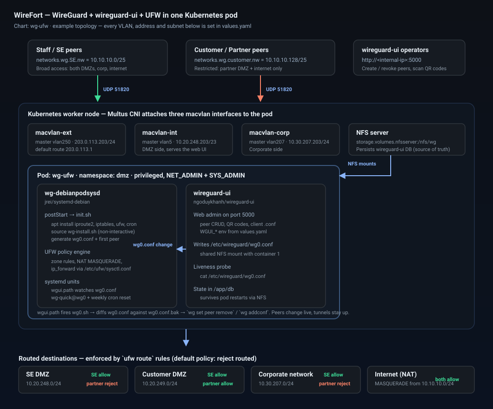
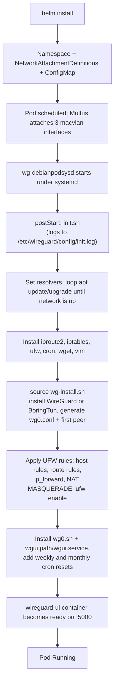
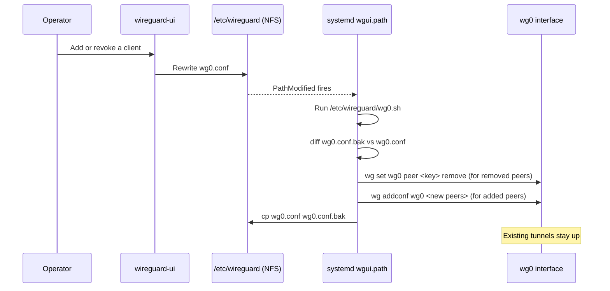

<div align="center">



# WireFort

**A self-contained, zone-aware WireGuard VPN gateway that runs as a single Kubernetes pod — kernel/userspace WireGuard, a web admin UI, and a UFW policy firewall, wired together and configured entirely from `values.yaml`.**

[](https://helm.sh)
[](https://kubernetes.io)
[](https://www.wireguard.com)
[](https://launchpad.net/ufw)
[](https://github.com/k8snetworkplumbingwg/multus-cni)
[](https://github.com/gnragoonanan/wirefort/actions/workflows/ci.yml)
[](LICENSE)
[](CONTRIBUTING.md)

**Chart name:** `wg-ufw` · **Maintainer:** [gnragoonanan (GnR)](https://github.com/gnragoonanan)

</div>

---

## Table of contents

- [Why WireFort](#why-wirefort)
- [Architecture](#architecture)
- [How a release boots](#how-a-release-boots)
- [Live peer reload](#live-peer-reload)
- [Firewall zone model](#firewall-zone-model)
- [Prerequisites](#prerequisites)
- [Quick start](#quick-start)
- [Configuration reference](#configuration-reference)
- [Operating the VPN](#operating-the-vpn)
- [Troubleshooting](#troubleshooting)
- [Security considerations](#security-considerations)
- [Known limitations](#known-limitations)
- [Repository layout](#repository-layout)
- [Contributing](#contributing)
- [Credits and attribution](#credits-and-attribution)
- [License](#license)

---

## Why WireFort

Most WireGuard-on-Kubernetes charts give you a tunnel and stop there. WireFort is built for the case where the VPN is a **gateway between trust zones**: staff peers and customer/partner peers terminate on the same server but must not reach the same networks.

Disclaimer: This project was created out of a complex VPN environment in a small footprint need and a number of great opensource projects were incorporated which are all referenced here: [Credits and attribution](#credits-and-attribution). This README was AI genreated.

| Capability | What it means in practice |
|---|---|
| **Two-tier peer zones** | The VPN subnet is split in half. Staff peers get one routing policy, customer/partner peers get another, enforced by `ufw route` rules rather than client-side `AllowedIPs`. |
| **Real layer-2 presence** | Multus + macvlan give the pod its own MAC and IP on up to three VLANs (external, DMZ, corporate), so the VPN endpoint looks like a physical appliance to the rest of the network. |
| **Web admin included** | [wireguard-ui](https://github.com/ngoduykhanh/wireguard-ui) runs as a sidecar with QR-code enrolment and per-client config download. |
| **Live peer reload** | A systemd path unit watches `wg0.conf` and applies peer additions and revocations to the running interface. Adding or revoking a client does not drop anyone else's tunnel. |
| **Non-interactive installer** | Nyr's well-known `wireguard-install` script, refactored to read environment variables instead of prompting, so it runs unattended from a `postStart` hook. |
| **Container-friendly WireGuard** | Falls back to [BoringTun](https://github.com/cloudflare/boringtun) in userspace when the host kernel module isn't usable inside the container. |
| **Everything in one pod** | No operator, no CRDs, no sidecar injection. One pod, two containers, one `values.yaml`. |

---

## Architecture

<div align="center">

</div>

The chart renders five objects:

| Template | Object | Purpose |
|---|---|---|
| `pod.yaml` | `Namespace` | Creates the target namespace (`namespace`, default `dmz`). |
| `netatt.yaml` | 3 × `NetworkAttachmentDefinition` | macvlan definitions for the external, internal/DMZ and corporate VLANs. |
| `init-configmap.yaml` | `ConfigMap` | Ships `init.sh` and `wg-install.sh` into the pod, rendered through `tpl` so they can reference chart values. |
| `pod.yaml` | `Pod` | Two containers sharing `/etc/wireguard` over NFS. |

> **Note** — this chart deploys a bare `Pod`, not a `Deployment` or `StatefulSet`. It is a single-instance network appliance pinned to one set of static IPs; see [Known limitations](#known-limitations).

---

## How a release boots

Expect **several minutes in `ContainerCreating`** on first start. That is normal: the init script is doing a full `apt` cycle inside the container.



---

## Live peer reload

This is the piece that makes the web UI and the kernel interface agree without restarting the tunnel.



Two cron jobs also perform a full `wg-quick down wg0 && wg-quick up wg0` at 01:00 every Sunday and on the 1st of each month, to clear any drift.

---

## Firewall zone model

The VPN subnet (`networks.wg.nw`, default `10.10.10.0/24`) is split into two halves:

| Zone | Values key | Default | Intended users |
|---|---|---|---|
| Staff / SE | `networks.wg.SE.nw` | `10.10.10.0/25` | Internal engineers and support staff |
| Customer / Partner | `networks.wg.customer.nw` | `10.10.10.128/25` | External customers and partners |

`init.sh` finishes with **`ufw default reject routed`**, so forwarding is deny-by-default and every permitted path is an explicit `ufw route allow`:

| Source zone | SE DMZ | Customer DMZ | Corporate network | Internet (NAT) |
|---|:--:|:--:|:--:|:--:|
| Staff / SE (`wgSEnet`) | allow | allow | allow | allow |
| Customer / Partner (`wgcnet`) | **reject** | allow | **reject** | allow |

Host-level (non-routed) rules applied to the pod itself:

| Rule | Purpose |
|---|---|
| `deny from $wgcnet to $inip` | Partner peers cannot talk to the gateway's own DMZ address |
| `allow to $inip port 5000/tcp` | wireguard-ui reachable from the DMZ |
| `allow to $corpip port 5000/tcp` | wireguard-ui reachable from the corporate network |
| `allow from any to $exip port 51820/udp` | The public WireGuard endpoint |

NAT is appended to `/etc/ufw/after.rules` as `-A POSTROUTING -s $wgnet -j MASQUERADE`, preceded by a `-F POSTROUTING` flush to avoid stale UFW/iptables entries. Forwarding is enabled by uncommenting the `net/ipv4/ip_forward` and IPv6 forwarding lines in `/etc/ufw/sysctl.conf`, because `sysctl` writes are not permitted in the pod.

> **Important** — because the UFW defaults are flipped from *allow* to *reject* partway through `init.sh`, the earlier `ufw route reject` rules are redundant by the time the script exits. Read the final block of [`init.sh`](ufw-wg-pods/wg-ufw/scripts/init.sh) as the authoritative policy, and always confirm with `ufw status numbered` after deploying.

---

## Prerequisites

| Requirement | Why |
|---|---|
| Kubernetes and Helm 3 | Chart uses `apiVersion: v2`; only core `v1` objects plus the Multus CRD are rendered, so there is no tight version floor. Tested on a Multus-enabled cluster — please report what you run it on. |
| [Multus CNI](https://github.com/k8snetworkplumbingwg/multus-cni) | Attaches the secondary macvlan interfaces listed in `podAnnotations` |
| `macvlan` CNI plugin + the master interfaces on every candidate node | `netatt.yaml` references `vlan250`, `vlan5`, `vlan207` by default — these host interfaces must already exist |
| Reachable NFS export | `/etc/wireguard` and the wireguard-ui database are NFS-backed; the export generally needs `no_root_squash` |
| Privileged workloads permitted in the namespace | The pod runs `privileged: true` with `NET_ADMIN` and `SYS_ADMIN`. Pod Security Admission must be set to `privileged` for the namespace |
| Host `/sys/fs/cgroup` available | Mounted read-only so `systemd` can run as PID 1 inside the container |
| `/dev/net/tun` on the node | Required when BoringTun is used instead of the kernel module |
| Outbound internet from the pod | `init.sh` installs packages with `apt` at startup; there is no pre-baked image |
| Static IPs reserved on each VLAN | The pod claims fixed addresses; make sure they are outside any DHCP pool |

---

## Quick start

```bash
git clone https://github.com/gnragoonanan/wirefort.git
cd wirefort/ufw-wg-pods
```

**1. Copy and edit the values.** The shipped `values.yaml` is a sanitized example using documentation address ranges. It will not work unmodified on your network.

```bash
cp wg-ufw/values.yaml my-values.yaml
$EDITOR my-values.yaml
```

At minimum change: `networks.macvlan.*` (interfaces and addresses), `networks.defaultgw`, `networks.dmz.*`, `storage.volumes.nfsserver`, `env.wgui.WGUI_USERNAME`, `env.wgui.WGUI_PASSWORD`, **and `podAnnotations`** (see the warning below).

> **Warning — the macvlan IPs are defined twice.** `networks.macvlan.*` feeds the `NetworkAttachmentDefinition`s and the container environment, while the `k8s.v1.cni.cncf.io/networks` annotation under `podAnnotations` carries its own hardcoded copy of the same addresses. **Both must be updated and kept identical**, or the pod will come up with addresses that don't match its firewall rules.

**2. Render and review before installing.**

```bash
helm lint ./wg-ufw
helm template wirefort ./wg-ufw -f my-values.yaml | less
```

**3. Install.**

```bash
helm install wirefort ./wg-ufw -f my-values.yaml --debug
```

**4. Watch the init script do its work.**

```bash
kubectl -n dmz get pod -w
kubectl -n dmz exec wirefort-wg-ufw -c wg-debianpodsysd -- tail -f /etc/wireguard/config/init.log
```

**5. Open the web UI** at `http://<networks.macvlan.inip>:5000` and sign in with your configured `WGUI_USERNAME` / `WGUI_PASSWORD`. Change them immediately if you left the defaults.

**Uninstall:**

```bash
helm uninstall wirefort
```

The pod's `preStop` hook removes `/etc/wireguard/wg*`. Peer definitions survive in the wireguard-ui database on NFS and are regenerated on the next start because `WGUI_MANAGE_START` is `true`.

**Re-running the setup by hand** (useful after editing values or recovering a half-finished install):

```bash
kubectl -n dmz exec -it wirefort-wg-ufw -c wg-debianpodsysd -- \
  /bin/bash /etc/wireguard/config/init.sh
```

---

## Configuration reference

### Core

| Key | Default | Description |
|---|---|---|
| `namespace` | `dmz` | Namespace created and used for every object |
| `containers.main` | `wg-debianpodsysd` | Name of the WireGuard/UFW container; also prefixes the ConfigMap name |
| `containers.wgui` | `wireguard-ui` | Name of the web UI container |
| `image.main` | `jrei/systemd-debian` | systemd-capable Debian base |
| `image.wgui` | `ngoduykhanh/wireguard-ui` | Web UI image |
| `image.tag` | `latest` | Applied to `image.main` only |
| `image.pullPolicy` | `IfNotPresent` | Pull policy for both containers |
| `resources` | 2 CPU / 4Gi requests, 4 CPU / 8Gi limits | Generous; tune down for small clusters |
| `securityContext` | `privileged: true`, `NET_ADMIN`, `SYS_ADMIN` | Needed for `wg`, `iptables` and `systemd` |

### macvlan networking

| Key | Default | Description |
|---|---|---|
| `networks.macvlan.extname` / `extif` / `exip` / `extnet` | `macvlan-ext`, `vlan250`, `203.0.113.203`, `203.0.113.0/24` | Public-facing attachment; hosts the WireGuard endpoint |
| `networks.defaultgw` | `203.0.113.1` | Default route injected into the external attachment |
| `networks.macvlan.intname` / `inif` / `inip` / `innet` | `macvlan-int`, `vlan5`, `10.20.248.203`, `10.20.248.0/23` | DMZ-side attachment; serves the web UI |
| `networks.macvlan.corpname` / `corpif` / `corpip` / `corpnet` | `macvlan-corp`, `vlan207`, `10.30.207.203`, `10.30.207.0/24` | Corporate-side attachment |
| `podAnnotations` | inline JSON | Multus attachment list — **must mirror the values above** |

### WireGuard

| Key | Default | Description |
|---|---|---|
| `networks.wg.wgif` | `wg0` | Interface name; the reload scripts assume `wg0` |
| `networks.wg.port` | `51820` | UDP listen port |
| `networks.wg.nw` | `10.10.10.0/24` | Full VPN subnet, used for the NAT MASQUERADE rule |
| `networks.wg.inip` | `10.10.10.1/24` | Server address advertised to wireguard-ui |
| `networks.wg.SE.nw` | `10.10.10.0/25` | Staff peer zone |
| `networks.wg.customer.nw` | `10.10.10.128/25` | Customer/partner peer zone |
| `env.boringtun` | `Y` | Enable BoringTun auto-updates when running in userspace mode |
| `env.dnsvalue` | `8.8.8.8, 8.8.4.4` | DNS pushed to clients |

### Destination zones

| Key | Default | Description |
|---|---|---|
| `networks.dmz.SE.nw` | `10.20.248.0/24` | Network only staff peers may reach |
| `networks.dmz.customer.nw` | `10.20.249.0/24` | Network both zones may reach |

### wireguard-ui

| Key | Default | Description |
|---|---|---|
| `env.wgui.WGUI_USERNAME` | `admin` | **Change this** |
| `env.wgui.WGUI_PASSWORD` | `admin` | **Change this** |
| `env.wgui.WGUI_MTU` | `1500` | Client MTU |
| `env.wgui.WGUI_PERSISTENT_KEEPALIVE` | `25` | Keepalive seconds |
| `env.wgui.WGUI_FIREWALL_MARK` | `""` | Optional fwmark |
| `env.wgui.WGUI_MANAGE_START` | `true` | Regenerate `wg0.conf` from the DB at startup |
| `env.wgui.WGUI_MANAGE_RESTART` | `true` | Let the UI request interface restarts |

### Storage

| Key | Default | Description |
|---|---|---|
| `storage.volumes.nfsserver` | `10.30.207.116` | NFS server address |
| `storage.volumes.nfspath` | `/nfs/wg` | Export path, mounted by both containers |
| `storage.volumeMounts.mwg` | `/etc/wireguard/` | Where `wg0.conf` lives, shared between containers |
| `storage.volumeMounts.mwguidb` | `/app/db` | wireguard-ui database |
| `storage.volumeMounts.mconfig` | `/etc/wireguard/config` | ConfigMap mount holding `init.sh`, `wg-install.sh` and `init.log` |

### Present but not wired up

`service`, `ingress`, `autoscaling`, `replicaCount`, `nodeSelector`, `tolerations`, `affinity` and `imagePullSecrets` exist in `values.yaml` as Helm scaffolding leftovers. **No template consumes them today** — setting them has no effect. See [Known limitations](#known-limitations).

---

## Operating the VPN

**Add or revoke a client:** use the web UI. The path unit applies the change to the live interface within seconds.

**Check firewall state:**

```bash
kubectl -n dmz exec wirefort-wg-ufw -c wg-debianpodsysd -- ufw status numbered
kubectl -n dmz exec wirefort-wg-ufw -c wg-debianpodsysd -- ufw status verbose
```

**Check tunnel state:**

```bash
kubectl -n dmz exec wirefort-wg-ufw -c wg-debianpodsysd -- wg show
```

**Force a full interface restart:**

```bash
kubectl -n dmz exec wirefort-wg-ufw -c wg-debianpodsysd -- \
  bash -c 'wg-quick down wg0 && wg-quick up wg0'
```

**Inspect the reload unit:**

```bash
kubectl -n dmz exec wirefort-wg-ufw -c wg-debianpodsysd -- systemctl status wgui.path wgui.service
```

---

## Troubleshooting

| Symptom | Cause and fix |
|---|---|
| Pod stuck in `ContainerCreating` for 5–15 minutes | Expected on first boot — `apt update && apt upgrade` plus package installs. Follow `/etc/wireguard/config/init.log`. |
| `init.log` loops on "Waiting for update and upgrade to complete" | The pod has no working route or DNS to the package mirrors. Check the external macvlan attachment and `networks.defaultgw`. |
| Pod never leaves `ContainerCreating`, no macvlan interfaces | Multus not installed, the `master` interface doesn't exist on the node, or the requested IP is already taken. Check `kubectl describe pod` events. |
| wireguard-ui container restarts repeatedly | The liveness probe `cat /etc/wireguard/wg0.conf` fails, meaning `wg-install.sh` never produced a config. Read `init.log`. |
| Web UI unreachable on `:5000` | Confirm you're hitting `networks.macvlan.inip` (or `corpip`) and that the matching `ufw allow to … port 5000` rule exists. |
| Peers connect but reach nothing | Forwarding or NAT not applied. Verify `/etc/ufw/sysctl.conf` has `net/ipv4/ip_forward=1` uncommented and that `/etc/ufw/after.rules` ends with the `POSTROUTING … MASQUERADE` block. |
| A new peer appears in the UI but can't connect | Check `systemctl status wgui.path`. If the unit isn't active, run `/etc/wireguard/wg0.sh` manually and inspect the output. |
| NFS mount errors on the pod | Export not reachable from the node, or `root_squash` is blocking the `chmod 600` on `wg0.conf`. |
| `helm test` fails | The bundled `templates/tests/test-connection.yaml` targets a `Service` this chart never creates. See [Known limitations](#known-limitations). |

---

## Security considerations

Read this section before exposing a WireFort pod to the internet.

- **Change the UI credentials.** `admin` / `admin` ships as the default. Move them into a `Secret` and reference it with `valueFrom.secretKeyRef` rather than leaving them as plaintext env values in `values.yaml`.
- **The web UI is plain HTTP.** Port 5000 is unencrypted. Terminate TLS in front of it or keep it on a management network only.
- **The pod is privileged.** `privileged: true` with `SYS_ADMIN` plus host `/sys/fs/cgroup` is close to node-level access. Run it in a dedicated namespace, restrict who can `exec` into it, and keep unrelated workloads off those nodes.
- **Packages are installed at runtime.** Every restart pulls the current Debian packages and the latest BoringTun build over the network, so the deployment is not reproducible and depends on upstream availability. Building a pre-baked image is the hardening path.
- **Images are unpinned.** `image.tag: latest` for the base, and no tag at all for wireguard-ui. Pin both to digests for production.
- **`wg0.conf` lives on NFS.** It holds the server private key. Use a dedicated, access-controlled export, and prefer an encrypted transport or a local volume if the NFS network is shared.
- **Verify the policy you actually got.** `ufw status numbered` after every deploy. Do not assume the rules in `init.sh` applied cleanly — the script has no error handling around the `ufw` calls.
- **Keep your own addresses out of the repository.** The shipped `values.yaml` deliberately uses RFC 5737 documentation and RFC 1918 private ranges. Keep your real topology in `values.yaml.working`, `values.yaml.local` or `my-values.yaml` — all three are gitignored, and CI fails the build if a public address appears in `values.yaml`.

Found a vulnerability? Please report it privately rather than opening a public issue.

---

## Known limitations

Honest list of rough edges, contributions welcome on any of them:

| Limitation | Detail |
|---|---|
| macvlan IPs are duplicated | `networks.macvlan.*` and `podAnnotations` must be edited in lockstep. Templating the annotation from the values would fix this. |
| VPN subnet partly hardcoded | `wg-install.sh` writes `Address = 10.10.10.1/24` and `AllowedIPs = 10.10.10.$octet/32` literally, so changing `networks.wg.nw` alone is not enough. |
| DNS partly hardcoded | `init.sh` writes `8.8.8.8` / `8.8.4.4` into `/etc/resolv.conf` directly instead of using the `dns` env var it is given. |
| Bare `Pod`, no controller | No rescheduling, no rolling updates, `replicaCount` is ignored. A `StatefulSet` with one replica would be an improvement. |
| Unused scaffolding | `service`, `ingress`, `autoscaling`, `nodeSelector`, `tolerations`, `affinity` are not referenced by any template. |
| `helm test` is broken | `templates/tests/test-connection.yaml` wgets a `Service` named after the release, which the chart does not create. |
| Orphaned helper | `_helpers.tpl` defines `wg-ufw.serviceAccountName`, which reads `.Values.serviceAccount` — a key that doesn't exist in `values.yaml`. Harmless only because nothing calls it. |
| Leftover file | `templates/deployment.bak` is dead code kept locally for reference. It is gitignored and excluded from packaged charts, so it isn't published. |
| No standard labels | Objects don't carry the `wg-ufw.labels` helper output, so `app.kubernetes.io/*` selectors won't find them. |
| Single interface name | The reload scripts and cron jobs assume `wg0` regardless of `networks.wg.wgif`. |
| IPv4 only in practice | The upstream installer has IPv6 paths, but this chart never sets `ip6`. |

---

## Repository layout

```
.
├── README.md
├── LICENSE                              # MIT, retaining Nyr's upstream notice
├── NOTICE                               # third-party components and licenses
├── CONTRIBUTING.md                      # includes firewall-change review rules
├── SECURITY.md                          # reporting, risk profile, hardening checklist
├── CODE_OF_CONDUCT.md
├── CHANGELOG.md
├── .gitignore                           # blocks site configs and key material
├── .github/
│   ├── workflows/ci.yml                 # chart, scripts and hygiene gates
│   ├── dependabot.yml
│   ├── PULL_REQUEST_TEMPLATE.md
│   └── ISSUE_TEMPLATE/
│       ├── bug_report.yml
│       ├── feature_request.yml
│       └── config.yml
├── docs/
│   └── images/
│       ├── wirefort-logo.svg            # README banner
│       ├── architecture.svg             # architecture diagram
│       └── icon.svg                     # square chart icon
└── ufw-wg-pods/
    ├── wg-ufw/                          # ← the Helm chart
    │   ├── Chart.yaml
    │   ├── values.yaml                  # sanitized example configuration
    │   ├── .helmignore
    │   ├── scripts/
    │   │   ├── init.sh                  # postStart: packages, UFW policy, systemd units, cron
    │   │   └── wg-install.sh            # non-interactive WireGuard/BoringTun installer
    │   └── templates/
    │       ├── pod.yaml                 # Namespace + two-container Pod
    │       ├── netatt.yaml              # 3 × NetworkAttachmentDefinition
    │       ├── init-configmap.yaml      # scripts rendered through tpl
    │       ├── _helpers.tpl
    │       ├── NOTES.txt                # post-install summary of IPs, URL, credentials
    │       └── tests/test-connection.yaml
    ├── wireguard-install-GR-mod.sh      # standalone ENV-driven installer (bare metal / VM)
    ├── wireguard-install-env-auto.sh    # earlier automated variant
    └── wireguard-install.sh.bkup        # pristine upstream copy for diffing
```

The two standalone `wireguard-install-*.sh` scripts in `ufw-wg-pods/` are the bare-metal ancestors of `wg-ufw/scripts/wg-install.sh`. They're kept because they're useful outside Kubernetes — same environment-variable interface, no Helm required. `wireguard-install.sh.bkup` is the unmodified upstream script, kept so anyone can diff it against the derivative and see exactly what changed.

### Your own configuration

`values.yaml` ships as a **sanitized example** using RFC 5737 documentation and RFC 1918 private addresses. Keep your real topology in one of these, all of which are gitignored and excluded from packaged charts:

| File | Use |
|---|---|
| `ufw-wg-pods/wg-ufw/values.yaml.working` | A full working copy of your site configuration |
| `my-values.yaml` | A `-f` override passed at install time |
| `values.yaml.local` | Alternative local override name |

CI enforces this: the build fails if an address outside the private or documentation ranges appears in `values.yaml`, if key material is tracked, or if a local override finds its way into a packaged chart.

---

## Contributing

Issues and pull requests are welcome, especially on anything in [Known limitations](#known-limitations). Read [CONTRIBUTING.md](CONTRIBUTING.md) first — it covers the rules for firewall policy changes, which need more care than a normal patch.

Before opening a PR, run what CI runs:

```bash
helm lint ./ufw-wg-pods/wg-ufw
helm template test ./ufw-wg-pods/wg-ufw > /dev/null
bash -n ufw-wg-pods/wg-ufw/scripts/*.sh
shellcheck --severity=error ufw-wg-pods/wg-ufw/scripts/init.sh
```

`wg-install.sh` carries inherited ShellCheck findings from upstream; CI reports those but doesn't enforce them.

Two things CI will reject: site-specific addresses in `values.yaml`, and any tracked key material. Please also note which Kubernetes distribution and CNI you tested against — and for a policy change, which **denials** you verified, not just which access still worked.

- [Code of Conduct](CODE_OF_CONDUCT.md)
- [Security policy](SECURITY.md) — report vulnerabilities privately, not as issues
- [Changelog](CHANGELOG.md)

---

## Credits and attribution

WireFort is glue around other people's excellent work. Credit where it is due:

| Project / author | Contribution to WireFort | License |
|---|---|---|
| **[Jason A. Donenfeld](https://www.zx2c4.com) — [WireGuard](https://www.wireguard.com)** | The VPN protocol and tooling everything here is built on | GPL-2.0 (kernel module), various |
| **[Nyr](https://github.com/Nyr) — [wireguard-install](https://github.com/Nyr/wireguard-install)** | `wg-ufw/scripts/wg-install.sh` and the standalone `wireguard-install-*.sh` scripts are derivatives of this installer. Copyright © 2020 Nyr. | [MIT](https://github.com/Nyr/wireguard-install/blob/master/LICENSE) |
| **[Khanh Ngo (ngoduykhanh)](https://github.com/ngoduykhanh) — [wireguard-ui](https://github.com/ngoduykhanh/wireguard-ui)** | The web admin interface running as the `wireguard-ui` sidecar. Copyright © 2020 Khanh Ngo. | [MIT](https://github.com/ngoduykhanh/wireguard-ui/blob/master/LICENSE) |
| **[Cloudflare](https://www.cloudflare.com) — [BoringTun](https://github.com/cloudflare/boringtun)** | Userspace WireGuard implementation used when the kernel module isn't available in-container | BSD-3-Clause |
| **[Julien Reichardt (j8r / jrei)](https://github.com/j8r) — [systemd-debian](https://hub.docker.com/r/jrei/systemd-debian)** | The systemd-capable Debian base image that makes path units and cron possible inside the pod. Copyright © Julien Reichardt. | [ISC](https://github.com/j8r/dockerfiles/blob/master/LICENSE) |
| **[UFW](https://launchpad.net/ufw)** — Jamie Strandboge and Canonical | The firewall frontend that expresses the whole zone policy | GPL-3.0 |
| **[Multus CNI](https://github.com/k8snetworkplumbingwg/multus-cni)** — Network Plumbing Working Group | Multi-interface pod networking | Apache-2.0 |
| **[Helm](https://helm.sh)** — CNCF | Packaging and templating | Apache-2.0 |

### Author and maintainer

**[gnragoonanan (GnR)](https://github.com/gnragoonanan)** — project author and maintainer. Specifically:

- Converted Nyr's interactive installer into a fully non-interactive, environment-variable-driven script suitable for automated container startup, and split the firewall logic out of the installer so the two concerns don't mix.
- Designed and wrote the `wg-ufw` Helm chart: the two-container pod, the Multus/macvlan attachments, the `tpl`-rendered script ConfigMap, and the `NOTES.txt` post-install summary.
- Built the two-tier UFW zone policy — the staff/partner split, the `ufw route` rule set, the NAT and forwarding workarounds for a container where `sysctl` writes are refused.
- Built the live peer-reload mechanism: `wg0.sh`, the `wgui.path`/`wgui.service` systemd pair, and the config-diff logic that adds and removes peers without disrupting active tunnels.
- Added the scheduled interface resets and the overall operational flow documented above.

*Shoutouts to everyone who filed issues and tested this against real customer and partner VPN topologies.*

### Trademarks

"WireGuard" and the WireGuard logo are [registered trademarks](https://www.wireguard.com/trademark-policy/) of Jason A. Donenfeld. This is an independent, unaffiliated project. Kubernetes is a registered trademark of The Linux Foundation. Ubuntu is a registered trademark of Canonical Ltd.

---

## License

Released under the [MIT License](LICENSE).

Portions of `wg-install.sh` and the standalone installer scripts derive from [Nyr/wireguard-install](https://github.com/Nyr/wireguard-install), Copyright © 2020 Nyr, also MIT licensed. That copyright notice is retained in the file headers and must stay there in any redistribution.

Every bundled and installed component remains under its own upstream license. See [NOTICE](NOTICE) for the full inventory, including which files are derivative works and what changed.

<div align="center">

**If WireFort saved you a weekend, a star is appreciated.**

Built by [gnragoonanan (GnR)](https://github.com/gnragoonanan)

</div>
